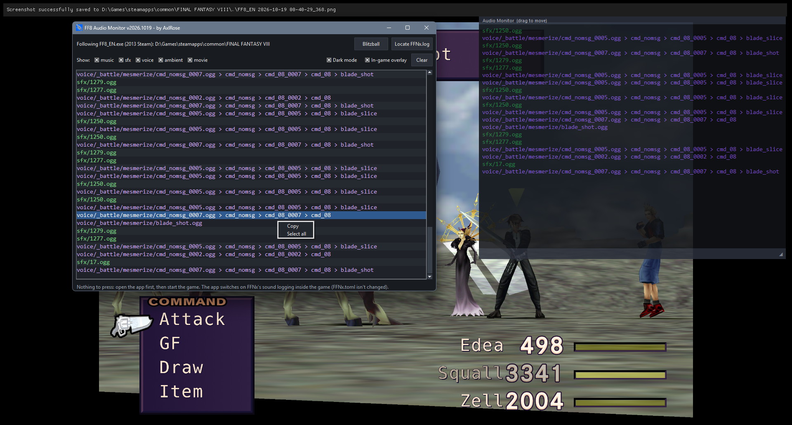
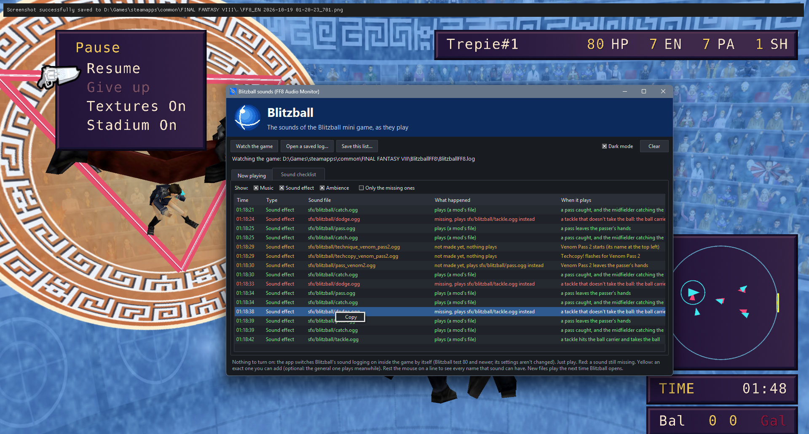

# FF8 Audio Monitor



Shows every audio file Final Fantasy VIII plays, live, while you play.

Made for audio modders (it was built for EchoS): see which file to replace.

## Features

- Music, sound effects, voices, ambient sounds and movie audio
- Nothing to set up or press: open the app, then start the game
- Finds the game and its `FFNx.log` by itself, wherever it's installed
- Only the audio lines, one color per type, no back to back repeats
- Battle voices: every name FFNx tried, on one row, most specific first
- Hide the types you don't need, copy any line
- **In-game overlay** floats the latest lines over the game (no Alt+Tab)
- **Locate FFNx.log** opens a saved log to see every file it used
- Starts in dark mode: untick **Dark mode** for the light look

## Works with

- FFNx through the Junction VIII mod manager
- Final Fantasy VIII Remastered and the 2013 Steam version
- Only these were tested, and they're the only ones supported
- A modding tool, not a companion app or a trainer

## Download

- Get `echos_audio_monitor.zip` from the [latest release](https://github.com/AxlRose-RX/FF8-Audio-Monitor/releases/latest)
- Unzip it anywhere and run `echos_audio_monitor.exe`
- Keep the `_internal` folder next to the .exe

## How to use

1. Open the app
2. Start the game through Junction VIII
3. Play: each sound shows up as it plays

## FFNx settings

- Nothing to change in `FFNx.toml`: the app turns these on inside the running game

```toml
trace_music = true
trace_sfx = true
trace_voice = true
trace_ambient = true
trace_movies = true
use_external_music = true
use_external_sfx = true
```

- They live only in the game's memory and are gone when it closes
- Open the app before the game, so it can switch the last two on in time
- Game started first? The app tells you: start the game again
- With the last two on, a sound with no .ogg file is silent (FFNx has no fallback)
- Running the game as administrator? Run the app as administrator too

## Blitzball mini game

- The **Blitzball** button opens a second window for the Blitzball FF8 mod
- It lists Blitzball's own music, sound effects and crowd as they play
- Nothing to turn on (Blitzball FF8 test 80 and newer)



- **Now playing**: each sound, what happened, and when that sound is used
- **Sound checklist**: every sound Blitzball has a place for
- Red: a sound still missing
- Yellow: an optional exact sound, like `tackle_venom.ogg` under `tackle.ogg`
- The general sound plays until the exact one is made
- Open the arrow on a line to see its exact sounds
- Rest the mouse on a line to see every name that sound can have
- Takes: `pass_1.ogg` to `pass_16.ogg`, a different one each time
- **Open a saved log**: reads `BlitzballFF8\BlitzballFF8.log` in the game folder
- `BlitzballFF8.prev.log` next to it is the game before
- **Save this list**: writes everything to a text file

## Build it yourself

1. Download **Source code (zip)** from any release
2. Install [Python 3](https://www.python.org/downloads/) (3.8 or newer)
3. Double-click `build_exeonedir.bat` (it installs everything it needs)
4. Find the app in `dist\echos_audio_monitor`

## Credits

- Made by AxlRose, with Claude (Anthropic's AI) helping write the code
- Questions and bug reports: [Tsunamods Discord](https://discord.com/invite/7Rsvsewghz)
